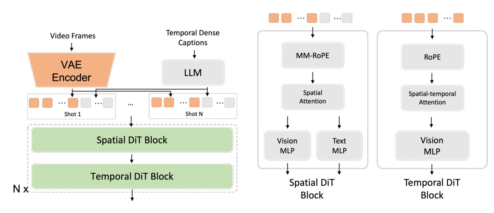

# 视频 DiT：空间、时间和文本怎样在注意力中交互

视频生成主干接收的通常不是 RGB 像素，而是 VAE 压缩后的带噪潜变量。它要完成两种关联：画面中的物体应与文本要求一致，同一个物体在连续时间里也应保持合理运动。空间与时间解耦的 DiT，把这两种关联拆到交替执行的注意力层中，以降低全时空建模的成本。

## 潜变量怎样进入 Transformer

设视觉潜变量形状为 `B×C×T×H×W`。将每个网格位置投影到隐藏维度 $d$，得到 `B×T×H×W×d`，再按注意力层需要组织成序列。文本经过编码器后也投影到可交互的特征空间。

有的模型先把多个潜空间位置合成一个 patch，有的直接把每个位置作为 token。没有 patchification 仍然需要输入投影，不能把潜变量通道数直接当成全部注意力头的维度。



图中空间块同时处理视觉和文本，时间块处理视觉序列。两者的分工让语义约束能够在空间层进入画面，再通过后续时空交互影响运动。

## 空间层怎样融合文字与画面

MMDiT 为视觉与文本保留各自的归一化、QKV 投影和前馈网络，再把两种模态的 Q、K、V 沿 token 维拼接：

$$
Q=[Q_v;Q_c],\qquad K=[K_v;K_c],\qquad V=[V_v;V_c].
$$

联合自注意力计算为：

$$
Y=\operatorname{softmax}\left(\frac{QK^\top}{\sqrt{d_h}}+A\right)V.
$$

$d_h$ 是单头维度，$A$ 是可见性掩码。视觉 query 可以读取文本 key/value，文本 query 也能读取视觉 key/value；输出再拆回两种模态，各自经过投影、残差和前馈网络。

这与单向文本交叉注意力不同。后者通常只由视觉生成 query，文本提供 key/value，输出仍是视觉序列。不能把“文本是条件”统一解释成“文本永远只出 K/V”。

梯度也不会按“先 Q、再 K、最后 V”的固定顺序决定谁更重要。它沿整个计算图对各条路径求导；参数是否更新，取决于路径是否可达以及是否被冻结。Q/K normalization 则是控制注意力数值尺度的一种手段。

## 时间层存在两种不同的组织方式

设每帧有 $P=HW$ 个空间位置。最便宜的时间注意力，把同一位置在所有帧上的 token 串起来，序列形状为 `B×P` 组长度为 $T$ 的序列。它能直接关联某个位置的时间变化，但一个物体移动到邻近位置后，需要其它空间层帮助传递信息。

另一种做法是在每帧划分空间窗口，窗口含 $m$ 个位置，把同一窗口跨所有帧的 token 合并，形成 $P/m$ 组长度为 $Tm$ 的序列。这样一次注意力可以同时看到时间变化和窗口内位移。

| 组织方式 | 注意力输入形状 | 可直接交互的范围 |
|---|---|---|
| 逐位置时间注意力 | `B×P, T, d` | 一个空间位置上的所有帧 |
| 窗口时空注意力 | `B×(P/m), Tm, d` | 一个空间窗口内的所有帧与位置 |

从 `B,T,nwin,m,d` 出发，窗口时空形式先重排成 `B,nwin,T,m,d`，再合并 $T$ 和 $m$。如果把 $m$ 合进 batch，得到的依然是逐位置时间注意力，并没有窗口内空间交互。

## 复杂度为什么要乘回帧数和位置数

只考虑每个注意力头的 token 连接数，四种结构的成本分别为：

$$
\begin{aligned}
C_{\mathrm{full}}&=(TP)^2,\\
C_{\mathrm{spatial}}&=TP^2,\\
C_{\mathrm{temporal}}&=PT^2,\\
C_{\mathrm{window}}&=\frac{P}{m}(Tm)^2=PT^2m.
\end{aligned}
$$

空间加逐位置时间注意力的总成本是 $TP^2+PT^2$。帧内空间注意力要做 $T$ 次，逐位置时间注意力要做 $P$ 次，这两个重复次数不能省略。若使用窗口时空形式，时间项还要乘窗口面积 $m$。

取 $T=16$、$H=W=32$、$P=1024$、$m=4$，全时空有约 2.68 亿个连接，空间项约 1678 万，逐位置时间项约 26 万，窗口时空项约 105 万。连接数的大幅下降解释了结构化注意力的价值，但真实速度还受投影、前馈网络、kernel 和显存访问影响。

在乘加计为两次操作的约定下，标准 MHA 子层的粗略 FLOPs 为：

$$
8Nd^2+4N^2d.
$$

前一项来自 QKV 和输出投影，后一项来自 QK 与 AV；扩展比例为 $r$ 的普通两层 FFN 另需约 $4rNd^2$。GQA 减少 K/V 头数，能降低投影和缓存开销，但每个 query 头仍然计算自己的注意力，二次交互项不会自动消失。

## 输入变大，为什么权重可以不变

线性层作用于最后的特征维度 $d$，权重不含 token 数 $N$。增加分辨率主要增加 token 行数，因此参数形状可以保持不变；LayerNorm 的参数同样沿特征维度定义。

形状合法却不等于质量可靠。更大的位置范围、不同宽高比、物体在窗口间移动和长序列训练分布，都可能改变生成效果。扩展模型时，应分别检查张量是否合法、算力是否可承受、生成是否仍然正确，而不能只因为前向没有报错就认为完成了分辨率适配。

## 从极简代码到真实实现

注意力的区别首先体现在谁成为序列维。输入为 `B,T,H,W,d` 时，逐位置时间形式可以写成：

```python
b, t, h, w, d = x.shape
seq = x.permute(0, 2, 3, 1, 4).reshape(b*h*w, t, d)
y = attention(seq)  # 每组只读同一位置的 T 个时间点。
```

窗口时空形式则把一个窗口的时间与空间位置一起合并为长度 $Tm$。两种 reshape、逆变换和多模态拼接见 [attention_layout.py](../examples/attention_layout.py)。真实投影与 block 可读 [Wan 模型](https://github.com/Wan-Video/Wan2.1/blob/9737cba9c1c3c4d04b33fcad41c111989865d315/wan/modules/model.py)，多模态窗口实现可读 [VINCIE attention](https://github.com/ByteDance-Seed/VINCIE/blob/97cd2c5701e694dabcfea320c0cf59893d427fab/models/dit/blocks/attention/mmattn.py)；它们是不同基座的结构，不能混用 checkpoint。
