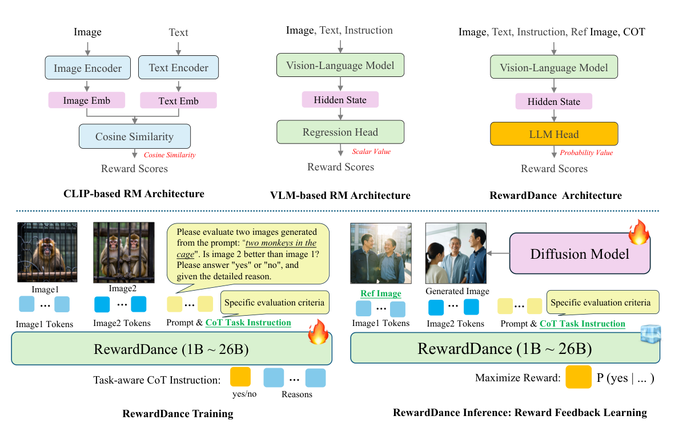

# 生成模型的后训练：谁在学习，奖励又在判断什么

一个视频系统里，描述视频的模型、改写提示的模型、生成视频的模型和评价视频的模型，可能分别经过不同训练。它们都可能出现 SFT 或偏好优化，但输入、输出和损失并不相同。先区分训练对象，才能理解一套后训练流程真正改变了什么。

## 四种模型，四种任务

| 模型 | 输入与输出 | 主要学习目标 |
|---|---|---|
| Caption 模型 | 视频与描述要求 → 事实描述 | 不漏事件、不编造内容、时间顺序正确 |
| 提示改写器 | 用户要求 → 稠密生成指令 | 保留意图，补充有效且不冲突的细节 |
| 生成器 | 带噪潜变量与条件 → 速度或其它预测量 | 生成目标分布中的内容 |
| 奖励模型 | 内容、要求、参考或对照 → 判断信号 | 与可用性和人类偏好一致 |

语言模型的 SFT 通常预测答案 token，视频生成器的 SFT 则可以继续使用速度回归，只是换成更高质量、更有针对性的数据。提示改写器采用 LoRA，也不说明视频生成器一定采用同一种适配方法。

## SFT 的作用在于改变有效训练分布

基础模型见过的数据规模大，但不一定集中在实际业务需要的质量标准。SFT 选择经过核实的高质量样本，用较小学习率继续训练，让模型更稳定地表达目标风格、动作或控制方式。

筛选不能只偏向漂亮静态画面。若高运动、多人交互和复杂遮挡都被筛掉，SFT 可能提高美感，却让模型越来越倾向慢动作。需要保留这些难例切片，独立观察回归。

## 语言 DPO 比较的是同一输入下的两个答案

偏好对包含输入 $x$、较好答案 $y_w$ 和较差答案 $y_l$。当前模型为 $\pi_\theta$，固定的 SFT 副本为 $\pi_{\mathrm{ref}}$，定义：

$$
\Delta_\theta=
\log\frac{\pi_\theta(y_w\mid x)}{\pi_{\mathrm{ref}}(y_w\mid x)}
-\log\frac{\pi_\theta(y_l\mid x)}{\pi_{\mathrm{ref}}(y_l\mid x)}.
$$

$$
\mathcal{L}_{\mathrm{DPO}}=-\mathbb{E}\log\sigma(\beta\Delta_\theta).
$$

视频 caption 的负答案可以由扰动视频诱导产生，但训练比较时，两种答案仍应放在同一个原始输入下计算概率。答案概率通常只累计有效的输出 token，不能把视频输入或 padding 当作答案。

$\beta$ 与偏好 logit 的缩放及隐式正则推导有关，实际更新还受学习率、训练步数、样本 margin 和长度处理影响。不能只凭一个数值断言训练保守或激进，需要同时记录实际偏移、胜率和基础能力退化。

## GRPO 怎样用于视觉生成

视觉 GRPO 将逐步去噪视为策略：状态包括当前潜变量、时间和条件，动作是下一步的随机状态。对同一提示生成一组结果，用组内相对奖励形成优势：

$$
A_i=\frac{r_i-\overline r}{s_r+\varepsilon}.
$$

再根据新旧策略的转移概率比率做截断更新。多个奖励可以分别标准化优势后聚合，避免数值尺度大的奖励自然压过其它维度。

固定初始噪声的 ODE 轨迹是确定的，但更换初始噪声仍会产生不同结果。采用 SDE 的一个关键作用，是为逐步策略更新提供非退化的随机转移密度。共享组内初始噪声、由采样过程产生轨迹差异，则是一种控制组内比较的具体设计。

视觉偏好学习也可以直接最大化复合奖励，或使用其它可微反馈方法。Seedance 1.0 的反馈学习采用直接奖励最大化；不能因为方法目标相近，就把它与 DanceGRPO 当成同一个训练算法。

## 奖励模型为什么决定优化方向

奖励可以由相似度、回归分数或生成式判断提供。生成式奖励将“是否更好”变成带任务标准和参考的比较问题，再取特定答案的概率作为信号。



这种形式可以利用视觉语言模型的指令与上下文能力，但模型更大不意味着永远不会被利用。奖励高可能只是模型更擅长命中评分器偏好，而不代表动作、身份和可交付性都提高。

奖励方差也不能直接代替输出多样性。分数变化大，可能来自任务难度差异；分数很集中，也可能是评分器不敏感。应同时看独立人工胜率、重复构图、模板率、动作幅度和任务遵循。

## 什么时候进入 RL，什么时候停止

先做高质量 SFT，再用固定候选重排测试奖励是否与人工一致。只有它能区分真实改善和表面讨好，才适合进一步驱动生成器更新。每轮固定 reward 版本，保留没有参与奖励训练和阈值调整的验证集。

如果奖励持续上涨，人工可用率却下降，或者动作越来越慢、肤质越来越平、构图越来越重复，就应停止并回到数据和奖励定义。优化器负责把模型推向高奖励区域，奖励目标是否代表业务需要，仍必须通过独立评价来确认。

## 从极简代码到真实实现

组内优势只在同一个提示的候选之间计算，不能把不同任务混成一组：

```python
# rewards: [batch, group_size]
centered = rewards - rewards.mean(-1, keepdim=True)
advantage = centered / (rewards.std(-1, keepdim=True, correction=0) + 1e-6)
```

DPO、组内优势和截断目标的核心计算见 [preference_objectives.py](../examples/preference_objectives.py)。完整采样、奖励和更新路径看 [DanceGRPO Hunyuan 训练](https://github.com/XueZeyue/DanceGRPO/blob/15cc71d53cc2e6e18a68ee607d5fb6ba9a99e344/fastvideo/train_grpo_hunyuan.py)。仅有优势公式还不是视觉 GRPO；真实实现还需要 SDE 转移密度、old policy 与时间采样。
