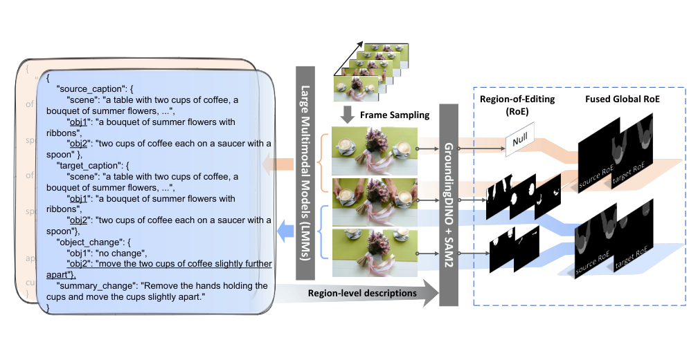

# 视频局部编辑：怎样做到指定时间、指定变化和其它内容保持

“把第二到第四秒的外套换成红色，其它不动”包含三个不同要求：改哪里、改什么、什么必须保持。生成一个看起来相似的新视频，只完成了其中很小一部分。可靠的编辑系统必须把保持条件变成数据和计算约束。

## 时间指令怎样变成帧范围

先把自然语言转换为源视频版本、半开时间区间 $[2,4)$、目标主体和服装区域，再列出必须保持的脸、姿态、背景和音轨。

固定 24 fps 且时间起点为零时，该区间包含帧号 48 到 95。可变帧率视频则应按真实时间戳选帧，不能只用时间乘平均 fps。还要约定第四秒以后是恢复原色，还是延续编辑后的外观；两者对应不同目标。

## 为什么需要三种 mask

用户允许修改的像素区域，经过 VAE 和 DiT 后未必仍对应一组精确独立的 token。卷积感受野、时间压缩和 patch 都会把邻近区域混在一起。因此应区分：

| mask | 作用 |
|---|---|
| 编辑 mask | 用户允许最终改变的区域与时间 |
| 上下文 mask | 模型需要读取或重建的邻域 |
| 损失 mask | 哪些位置具有有效监督 |

模型工作区可以比最终编辑区更大，以获得边界上下文；输出时再按交付约定保留源内容。如果修改光照会改变区域外阴影，就必须扩大允许变化的范围，不能同时要求物理一致和外部像素绝对不变。

## 生成式补全与像素保留怎样配合

生成式补全以源潜变量、mask 和指令为条件，重新生成工作区，适合较大语义变化，但容易出现外区漂移和边界闪烁。另一条路线是只生成局部，再复用未编辑的源帧。

设 $M$ 为最终编辑权重，合成结果为：

$$
x_{\mathrm{out}}=M\odot x_{\mathrm{generated}}+(1-M)\odot x_{\mathrm{source}}.
$$

当 $M=0$ 的位置直接复用源像素，就不必要求有损 VAE 在这些位置实现逐像素无损重建。边缘可使用软 mask，但发丝、运动模糊、透明材质和前后遮挡仍需专门处理。原音轨若必须保持，也应直接复用相应采样，并检查混流后的延迟。

## 编辑监督从哪里来

真实视频天然包含外观、姿态和物体状态的变化，可以用于挖掘编辑指令和变化区域。



这类数据容易扩展，却不是精确的单因素真值：两帧之间可能同时发生相机运动、遮挡和光照变化。把它们都标成“只换衣服颜色”，会教模型连背景和姿态一起修改。

因此可分三类制作：受控三维场景重渲染，提供精确几何和 mask；人工制作的真实编辑前后对，记录具体后期操作；视频挖掘的弱监督对，保留置信度并抽检。三类数据可以混合训练，但不能给它们相同的真值含义。

## 白模与绿幕分别控制什么

白模将布局、相机和运动轨迹先固定，再让生成模型补材质、风格与光照。若同时输出 depth、normal、pose 和相机参数，几何条件更明确；训练时必须保持它们与目标帧严格对齐。由单目视频估计的深度和相机存在误差，需要与精确渲染真值区分。

绿幕编辑先处理 alpha、绿溢色、发丝和运动模糊，再生成背景并做前景光色融合。若还希望衣服受风、头发运动和接触阴影随背景重新变化，任务已经超出单纯抠像，需要重新生成部分前景，并额外验证身份与动作保持。

## 编辑是否成功，要拆开评价

至少分别检查目标变化、非目标保持、时间边界、边界闪烁、遮挡和音轨一致性。颜色替换可要求外区像素相同；视角变化则应检查角色、语义与几何保持，逐像素比较不再合适。

缓存不是时间戳编辑的必要前提。修改过去内容后，依赖它的后续状态需要刷新；为了先保证正确，应以完整重算为基线，再优化缓存更新。最终交付检查应逐帧覆盖编辑区间的前后边界，而不是只挑一张变化最明显的截图。

## 从极简代码到真实实现

最终保持源像素，只需要明确合成权重；模型内部的工作区和噪声覆盖则是另外两层逻辑：

```python
selected = (frame_pts >= start) & (frame_pts < end)
output = alpha * generated + (1 - alpha) * source
```

三种操作的极简代码见 [local_edit.py](../examples/local_edit.py)。真实多轮图像编辑看 [VINCIEGenerator](https://github.com/ByteDance-Seed/VINCIE/blob/97cd2c5701e694dabcfea320c0cf59893d427fab/generate.py)；视频和音视频条件流水线可从 [LTX pipelines](https://github.com/Lightricks/LTX-2/blob/daa6b16fc7f0f1628f2c9e36a303e3312b333cc6/packages/ltx-pipelines/README.md) 选择。VINCIE 的图像编辑入口本身不是时间戳视频编辑器。
