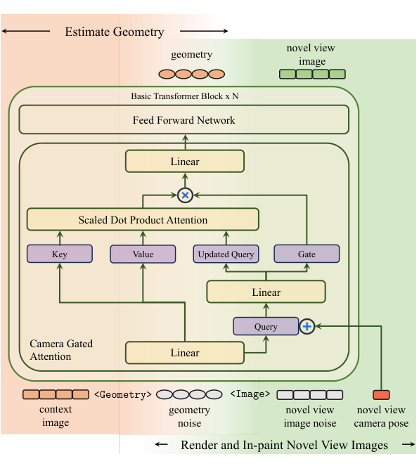

# 白模、相机与场景记忆：怎样让空间约束持续成立

让模型参考一张房间图，可以保持大致风格，却未必能记住相机转过去后被遮挡的桌子。空间控制需要回答两个问题：当前画面应该由哪个相机看到，以及之前不可见的物体在三维场景中处于什么位置。

白模和几何上下文提供了两类互补信息。前者把已知布局和运动先渲染出来，后者让模型显式读取或预测深度等结构。两者都可以帮助生成，但都不能把“看起来有三维感”当成几何真值。

## 白模应输出哪些条件

对于自有三维场景，优先导出同步的 clay RGB、深度、法线、实例 ID、相机内外参和物体轨迹。相机单位、轴方向、深度范围、镜头畸变和帧时间必须固定。

深度和法线可以作为规范化图像通过视觉条件支路编码，但它们有不同数值含义：相对深度不等于米制深度，法线通道也不等于普通 RGB。条件需附 modality/type 标记与有效区域，避免模型把控制图当作目标材质。

真实视频估计的深度与相机没有精确渲染的可信度。把估计结果用作弱条件时，应保留置信度、遮挡和缺失值，不通过随意补零把未知表面变成真实平面。

## 相机射线怎样表达视角

给定像素齐次坐标 $u$、相机内参 $K$、相机到世界旋转 $R$ 和相机中心 $o$，归一化世界射线方向为：

$$
d(u)=\frac{RK^{-1}u}{\lVert RK^{-1}u\rVert_2}.
$$

Plücker 表示将方向与矩联合：

$$
r(u)=[d(u),o\times d(u)].
$$

它把每个像素“从哪里看向哪里”作为条件。相机平移尺度改变会影响矩，因此必须与场景单位一致；只有旋转正确、位移单位错误，同样会让轨迹失真。

候选实现将射线图按视觉 latent 网格汇聚，再经独立投影进入相机支路。相机与深度已知时，不让模型先重新猜一遍它们。

## 几何上下文怎样成为记忆

另一条路线是让同一模型处理交错的 RGB、几何和下一视角任务：

```text
当前图像 → 当前几何 → 指定相机下的下一图像 → 下一几何 → …
```



图中相机影响 query 和输出门控，使模型在估计几何和生成新视角时使用不同条件。几何上下文可以让过去内容以显式结构参与后续生成，但同时增加序列长度；训练时随机去掉一部分几何上下文，可让模型兼容只用图像的路径。

Geometry-as-Context 的公开路线使用自己的交错生成基座，不能直接加载为 LTX 或 Wan 的插件。候选工程先实现已知白模与相机条件，只有场景导航确有收益时，再研究预测几何的辅助头或交错任务。

## 场景记忆不要只存第一帧

长期记忆可以分为静态结构、动态主体状态和视觉证据。静态结构包括相机坐标和固定物体，动态状态包括角色当前位置、拿着什么道具，视觉证据包括可重访视角的关键帧、深度和置信度。

每个新镜头从相机距离、可见性和新鲜度检索若干关键帧，而不是把所有旧视频无上限地拼入 attention。模型生成后，对高置信区域更新记忆，对新露出或矛盾区域保留不确定性，避免一次错误被写成永久场景真值。

首版记忆是外部数据结构与条件检索，不声称已完成三维重建。若使用深度重投影合成，需要处理遮挡和新露出区域；这些区域仍由生成器补全，并单独标记为新推断内容。

## 怎样测真正的空间保持

相机离开后返回同一位置，是很重要的检查。比较重访视角中的物体存在、位置、颜色和遮挡关系，往往比看连续两帧更能暴露“场景记忆”失败。

还应比较已知轨迹跟随、相机方向错误、动态物体与静态背景分离，以及深度置信度低时的退化。只有几何允许对齐的区域才使用重投影像素误差，遮挡和新露出区域单独评价。

极简射线表示见 [camera_rays.py](../../../algorithms/examples/camera_rays.py)。真实控制条件组织可读 [VACE](https://github.com/ali-vilab/VACE)，几何交错建模的机制来自 Geometry-as-Context；本方案没有声称已经实现相同的长程三维效果。
